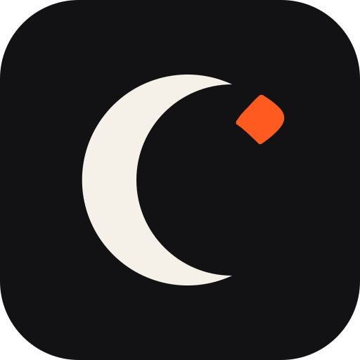

<p align="center"></p>

<h1 align="center">Falah</h1>

<p align="center">Prayer times, reminders and the qibla, by <a href="https://github.com/zimamlabs">Zimam</a>.</p>

Falah (فلاح, success) shows today's five prayers and the sunrise for where you are, tells you which prayer is next and how long is left, and points to the qibla. It works offline, has no account and sends nothing anywhere.

## What is in it

- **Prayer times** computed on the phone from the sun's position: Fajr, sunrise, Dhuhr, Asr, Maghrib and Isha, accurate to about a minute.
- **Next prayer** and the time left, updated as the day goes.
- **Qibla** direction from where you are.
- **Methods**: Egyptian General Authority (default), Muslim World League, Umm al-Qura, Karachi and North America, with Standard or Hanafi Asr.
- **Places**: Cairo, Alexandria, Makkah, Madinah, Riyadh, Dubai, Istanbul, London, New York and more.

Prayer times are a calculation, not an authority: check them against your local mosque or religious authority when it matters.

## Download

Get the file for your phone from the [latest release](../../releases/latest). Next to every file is a checksum file with the same name plus `.sha256`.

| System | File |
|---|---|
| Android phone (64-bit, almost every phone since 2016) | `Falah_<version>_Android_arm64-v8a.apk` |
| Android, older 32-bit | `Falah_<version>_Android_armeabi-v7a.apk` |
| Android emulator, Chromebook | `Falah_<version>_Android_x86_64.apk` |

```
sha256sum -c Falah_<version>_Android_arm64-v8a.apk.sha256
```

### Verify the Android download

Every APK is signed with Falah's own key. Android installs it without a store because the signature is valid, and shows its usual "unknown source" notice for anything that did not come from Google Play. To check a file is really ours, compare its signing certificate with this fingerprint:

```
SHA-256: CE:37:B1:30:E6:8E:27:4F:DD:62:5F:BB:EE:E3:96:60:DA:18:ED:44:47:1F:AB:CF:84:BE:DB:75:38:7A:17:22
```

```
apksigner verify --print-certs Falah_<version>_Android_arm64-v8a.apk
```

## Build

You need JDK 17 or newer and, for Android, the Android SDK (platform 36).

```
./gradlew :shared:desktopTest            # the prayer-time tests
./gradlew :composeApp:run                # run it on the desktop
./gradlew :composeApp:assembleDebug      # Android debug APKs
```

`shared` holds the calculation (plain Kotlin, tested without a screen) and `composeApp` holds the screens for both platforms.

## Roadmap

Notifications at each prayer (with a choice of which), your own location from the phone, a daily prayer log, a compass that follows the phone, and a home-screen widget. A Linux edition comes after version 1.

## Licence

MIT. See [LICENSE](LICENSE).
